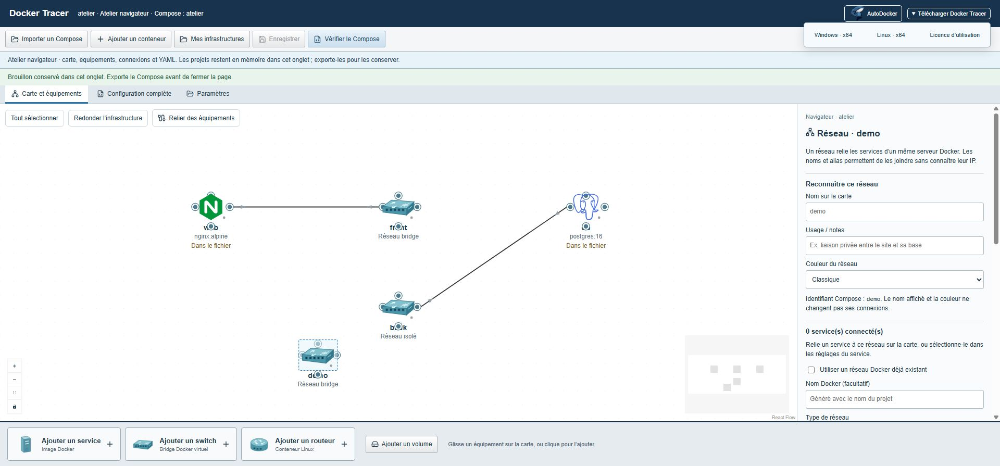
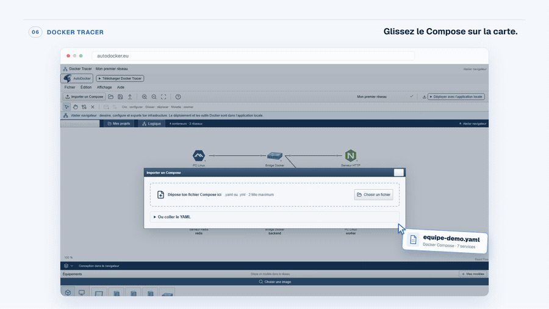

# Docker Tracer

**Explorer et faire évoluer une infrastructure Docker depuis une carte.**

Importez votre Compose, retrouvez ses services et ses réseaux, puis travaillez sur sa configuration.

Version **0.12.2 · Bêta** · [Toutes les versions](https://github.com/caroneloham/docker-tracer/releases) · [Documentation](#documentation)

## Ce que vous pouvez faire

| Visualiser | Modifier | Diagnostiquer en local | Préparer les changements |
| :--- | :--- | :--- | :--- |
| Déposer un Compose et explorer ses services, réseaux et volumes. | Travailler sur la carte et le YAML, puis exporter le résultat. | Consulter les conteneurs, les journaux, le terminal et les fichiers sur un hôte connecté. | Examiner les modifications avant de les appliquer à votre installation Docker. |

<strong>Voir une courte démonstration</strong>

## Choisir votre version

| Atelier dans le navigateur | Application locale |
| :--- | :--- |
| Importer, modifier et exporter un Compose depuis [autodocker.eu](https://autodocker.eu/essai/tracer/). | Utiliser l’atelier avec Docker local ou un hôte Linux distant par SSH. |
| Le fichier reste en mémoire dans l’onglet. Exportez-le pour le conserver. | Accéder à l’état réel des conteneurs, aux journaux, aux fichiers et au terminal. |
| La carte représente le Compose déclaré ; aucun moteur Docker n’est contacté. | Les opérations Docker demandent un moteur et les droits d’accès nécessaires. |

L’atelier navigateur n’exécute aucune commande ni aucun déploiement. Les fichiers externes référencés par `include`, `extends`, `.env` ou `env_file` ne sont pas chargés automatiquement depuis votre disque.

## Installer en local

| Windows x64 | Linux x64 |
| :--- | :--- |
| [Télécharger le ZIP](https://github.com/caroneloham/docker-tracer/releases/download/v0.12.2/Docker-Tracer-0.12.2-Windows-x64.zip), puis l’extraire entièrement. | [Télécharger l’archive](https://github.com/caroneloham/docker-tracer/releases/download/v0.12.2/Docker-Tracer-0.12.2-Linux-x64.tar.gz), puis l’extraire entièrement. |
| Lancer **Docker-Tracer.cmd**. | Lancer `./Lancer-Docker-Tracer.sh` dans le dossier extrait. |

Node.js est inclus. Le lanceur ouvre le navigateur avec une session locale protégée ; conservez privée l’adresse d’accès. Les projets et journaux restent dans `data/` à côté de l’application. Le serveur écoute sur `127.0.0.1:4310`.

Les [instructions Windows](packaging/README.md) et [Linux](packaging/README-Linux.md) détaillent les prérequis et l’arrêt du serveur.

## Deux projets complémentaires

**[AutoDocker](https://github.com/caroneloham/autodocker)** aide à créer l’infrastructure initiale. **Docker Tracer** aide à explorer et modifier une infrastructure existante. Vous pouvez passer le fichier Compose de l’un à l’autre.

## Documentation

- [Dépannage : erreurs courantes et solutions](docs/Depannage.md).

- [Wiki : installation et utilisation](https://github.com/caroneloham/docker-tracer/wiki).

- [Développer, construire les archives et lancer les tests](docs/Developper.md).
- [Périmètre des vérifications](VERIFICATION.md) · [Politique de sécurité et signalement privé](SECURITY.md).
- [Licences des composants tiers](THIRD_PARTY_NOTICES.txt) · [Provenance des logos](src/assets/brands/README.md).

Un problème ou une idée ? [Ouvrir une issue](https://github.com/caroneloham/docker-tracer/issues).

## État du projet et licence

Docker Tracer est en **bêta et encore en cours de finalisation**. En local, il peut agir sur Docker et sur des fichiers : vérifiez les aperçus et vos sauvegardes avant d’appliquer des changements. Ne publiez pas son port ni son API sur Internet. Les limites de validation sont détaillées dans la documentation.

Le code est accessible sous la [licence AutoDocker et Docker Tracer 1.0](LICENSE). L’usage professionnel, les modifications et la vente des infrastructures produites sont permis selon ses conditions. La vente du logiciel ou d’un accès payant à ses fonctions est interdite. Cette licence n’est pas une licence open source approuvée par l’OSI. Les composants et logos tiers conservent leurs propres conditions.

## Remerciements

Merci à [IngéPLUS](https://inge-plus.fr/avr-2026-bourses-ia-bac3-ingeplus-accompagne-les-talents-de-bts-vers-les-metiers-de-lia/) pour son soutien financier à travers la bourse qui m’avait été accordée à l’époque.
